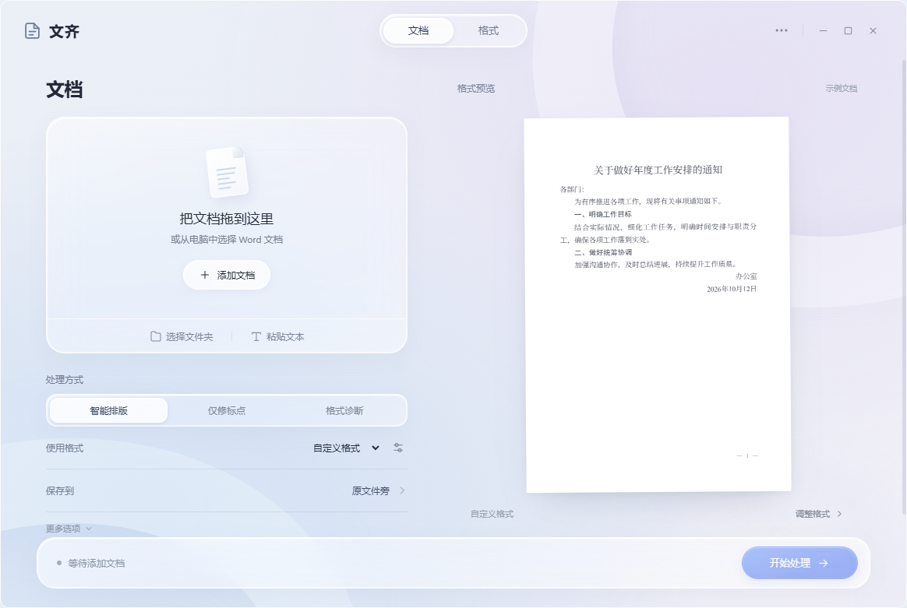

# 文齐 · WenQi

<p align="center"></p>
<p align="center"><strong>让文档格式整齐一致。</strong></p>
<p align="center">自定义 Word 格式 · 批量排版 · 标点修复 · 本地处理</p>
<p align="center"><a href="README_EN.md">English</a> · <a href="README_DEV.md">开发说明</a> · <a href="https://github.com/Weisiren-liu/wenqi/issues">问题反馈</a></p>

文齐是一个在本地运行的 Word 文档格式处理工具。新版采用液态玻璃桌面界面，以“文档”和“格式”两个工作区组织操作。选择自定义格式或内置预设，调整字体、字号、加粗、对齐、缩进、行距与段落间距，再批量应用到文档。

本项目基于 KaguraNanaga 的 `docformat-gui` **MIT 版 v1.8.8.2** 二次开发，保留原始版权与许可声明。本分支完成了配置路径统一、预设注册表整合、主界面重排、窄屏适配，以及 WenQi 更名与图标重绘。

## 界面



## 能力与边界

- **格式直接编辑**：“格式”工作区可调整主标题、主送机关、一级至四级标题、正文、落款、日期、附件和结束语的中英文字体等参数。
- **格式预设**：自定义格式默认选中，另有公文、学术论文、法律文书起始预设。修改值与预设分开保存，可恢复单行或全部参数，也可存为新格式。
- **分类设置**：段落、页面、表格、处理选项分开显示，参数自动保存；格式预览随修改更新。
- **批量处理**：多选文件或选择文件夹，统一输出；也可粘贴文本生成 `.docx`。
- **三种处理方式**：智能处理（修标点并应用格式）、格式诊断（只出报告）、仅修标点（保留原有排版）。
- **中文排版**：标点规范化、中文禁则、标题识别、页码和表格调整，保留内嵌图片及附件媒体节点。
- **处理修订**：可输出修订标记，供 Word 中复核格式变化。
- **离线运行**：文档处理在本地完成，无文档上传、遥测或后台网络请求。

当前段落识别仍以中文公文元素为基础，论文和法律预设提供的是排版起点。**格式诊断尚未按当前自定义参数逐项校验**。处理结果需要人工复核，字体缺失、复杂表格和特殊结构可能影响最终效果。

## 运行

当前仓库提供源码，预编译安装包尚未发布。后续安装包将在 [Releases](https://github.com/Weisiren-liu/wenqi/releases) 提供。

推荐 Python 3.11 或更高版本：

```bash
git clone https://github.com/Weisiren-liu/wenqi.git
cd wenqi
python -m venv .venv
```

Windows PowerShell：

```powershell
.\.venv\Scripts\Activate.ps1
python -m pip install -r requirements.txt
python docformat_gui.py
```

macOS / Linux：

```bash
source .venv/bin/activate
python -m pip install -r requirements.txt
python docformat_gui.py
```

Windows 新界面使用 Edge WebView2（当前 Windows 10/11 通常已安装）；macOS 使用系统 WKWebView。Linux 需要 GTK / WebKitGTK 和 PyGObject，例如 Debian / Ubuntu 安装 `python3-tk python3-gi gir1.2-webkit2-4.1`，再在环境中安装 `pywebview[gtk]`。也可在项目目录执行 `bash install.sh`，由安装助手创建环境并启动。

| 平台 | 文档支持 |
|---|---|
| Windows | `.docx`；`.doc` / `.wps` 转换需本机 Microsoft Office 或 WPS Office |
| macOS / Linux | `.docx`；其他格式请先转换 |

`.docx` 处理无需安装 Microsoft Word。请安装所选中文字体；字体回退可能改变外观。新界面使用本机浏览器的文件拖拽接口，支持一次添加多个文档。Python 3.8 / Windows 7 兼容版继续使用原 Tk 界面，拖拽依赖 `tkinterdnd2`。

## 使用

1. 拖入文档，或添加文件、文件夹、粘贴的文本。
2. 选择处理方式和格式；在“格式”工作区直接调整参数。
3. 选择保存位置，点击“开始处理”。
4. 在页面内查看结果并打开文件。默认在原文件旁生成带 `_processed` 后缀的新文件；遇到已有同名结果自动加序号。

格式和修改值重启后继续保留。为兼容已有设置，更名后仍使用 `DocFormatter` 用户配置目录，详见 [开发说明](README_DEV.md)。

## 开发与打包

```bash
python -m pip install -r requirements-dev.txt
python -m pytest -q
python -m pip install pyinstaller
python build.py windows   # 在对应系统运行 windows / linux / macos
```

产物以 `wenqi_` 开头，如 `wenqi_windows.exe`。GitHub Actions 支持手动构建；推送 `v*` 标签会构建并发布多平台包。Windows 7 兼容构建使用 Python 3.8 和 `requirements-win7.txt`，macOS 签名与公证需自行配置仓库密钥。

入口在 `docformat_gui.py`，新版界面在 `ui/`，本地桌面桥接与处理调度在 `scripts/desktop_ui.py`。排版核心在 `scripts/formatter.py`，诊断在 `scripts/analyzer.py`，Windows 转换在 `scripts/converter.py`。品牌信息集中于 `scripts/branding.py`。新界面的实现和验证见 [液态玻璃界面说明](docs/LIQUID_GLASS_UI.md)。

## 许可与来源

[MIT License](LICENSE) 允许使用、修改和分发，包括商业用途；分发时须保留原始版权与许可声明。原作者：**KaguraNanaga**。二次开发与维护：**Weisiren-liu**。本项目基线为上游 MIT 版 v1.8.8.2。

参见 [第三方依赖](THIRD_PARTY_LICENSES.md)、[隐私与免责声明](DISCLAIMER.md)、[品牌资源](docs/BRANDING.md)。反馈请提交 [Issue](https://github.com/Weisiren-liu/wenqi/issues)。
